# popgen-plot

GWAS / 群体遗传学论文配图的**统一定稿样式库**。

PCA（二维/三维）、ADMIXTURE 祖先成分、Fst 选择信号，三类图，一套样式。

---

## 为什么有这个仓库

每次让 AI 作图，出来的图都不一样：配色、字号、点大小、图例位置全凭随机。

根因不是 AI 不会画，而是**没有一个地方定义过「我们的图该长什么样」**。
原始脚本里，颜色是 `c("red","blue","green")`、大小是 `size = 2`、路径是
`C:/Users/xxx/Desktop/...`，散落在各个文件里——AI 拿到这些只能猜。

这个仓库解决三件事：

| 问题 | 做法 |
|---|---|
| 图不统一 | 样式全部集中在 `R/theme_popgen.R`，改一处全仓库生效 |
| AI 看不懂 | `AGENTS.md` 写明规范，AI 进仓库先读它 |
| 改完不知对不对 | `demo_data/` + `demo_out/` 提供可跑样例，跑一遍就知道 |

---

## 目录结构

```
popgen-plot/
├── AGENTS.md              # 给 AI 的作图规范（关键）
├── README.md
├── R/
│   ├── load_all.R         # 递归载入 R/ 下全部函数
│   ├── theme_popgen.R     # 统一样式：配色 / 字号 / 尺寸 / dpi
│   ├── Population Genetic Structure Analysis/    # 群体结构
│   │   ├── PCA_2D_Plot.R        PCA_2D_Plot()  PCA_Scree_Plot()
│   │   ├── PCA_3D_Plot.R        PCA_3D_Plot()
│   │   ├── Admixture_Plot.R    Admixture_Plot()
│   │   └── Tree_Pie_Plot.R      Tree_Pie_Plot()
│   ├── Population Genetic Diversity Analysis/    # 遗传多样性
│   │   ├── LD_Decay_Plot.R      LD_Decay_Plot()
│   │   └── SNP_Density_Plot.R   SNP_Density_Plot()
│   ├── Selection Signature Analysis/             # 选择信号
│   │   ├── FST_Manhattan_Plot.R    FST_Manhattan_Plot()
│   │   ├── XPCLR_Manhattan_Plot.R  XPCLR_Manhattan_Plot()
│   │   ├── XPEHH_Manhattan_Plot.R  XPEHH_Manhattan_Plot()
│   │   └── legacy/           # 改造前的原始手写脚本，仅供对照
│   └── General Plots/                            # 通用
│       └── Venn_Plot.R         Venn_Plot()
├── demo_data/             # 脱敏假数据（随机生成，无真实样本信息）
├── demo_out/              # 示例输出图
└── tools/
    ├── make_demo_data.R   # 重新生成 demo_data
    └── run_demo.R         # 跑一遍全部作图，生成 demo_out
```

### 命名约定

函数名 = **词之间用下划线分隔、以 `_Plot` 结尾，缩写保持全大写**，与文件名完全一致。
`LD_Decay_Plot.R` 里就是 `LD_Decay_Plot()`，不存在 `plot_` 前缀。

| 缩写 | 写法 |
|---|---|
| PCA / LD / SNP / FST | 全大写，如 `PCA_2D_Plot` `LD_Decay_Plot` `SNP_Density_Plot` |
| XP-CLR / XP-EHH | 去连字符全大写，如 `XPCLR_Manhattan_Plot` |

---

## 快速开始

在仓库根目录打开 R：

```r
source("R/load_all.R")

PCA_2D_Plot(
  eigenvec_path = "你的/pca.eigenvec",
  eigenval_path = "你的/pca.eigenval",
  group_path    = "你的/group.csv",       # 需要 SampleID + Breed 两列
  out_file      = "out/pca_2d.png"
)
```

验证所有函数是否正常：

```bash
Rscript tools/run_demo.R
```

---

## 图库

### 1. 二维 PCA（带 95% 置信椭圆）

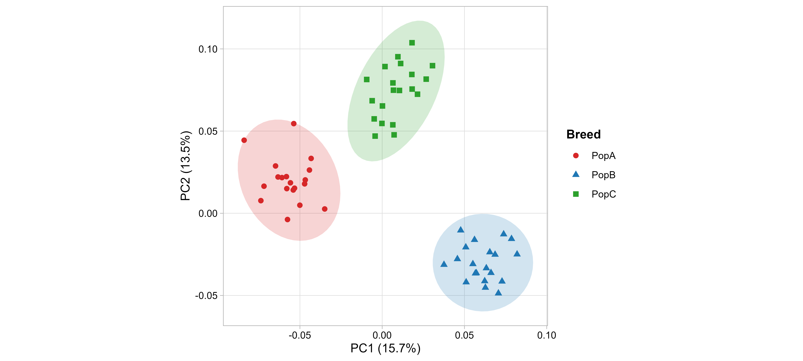

```r
PCA_2D_Plot("pca.eigenvec", "pca.eigenval", "group.csv",
            group_col = "Breed", out_file = "out/pca_2d.png")
```

### 2. PCA 碎石图

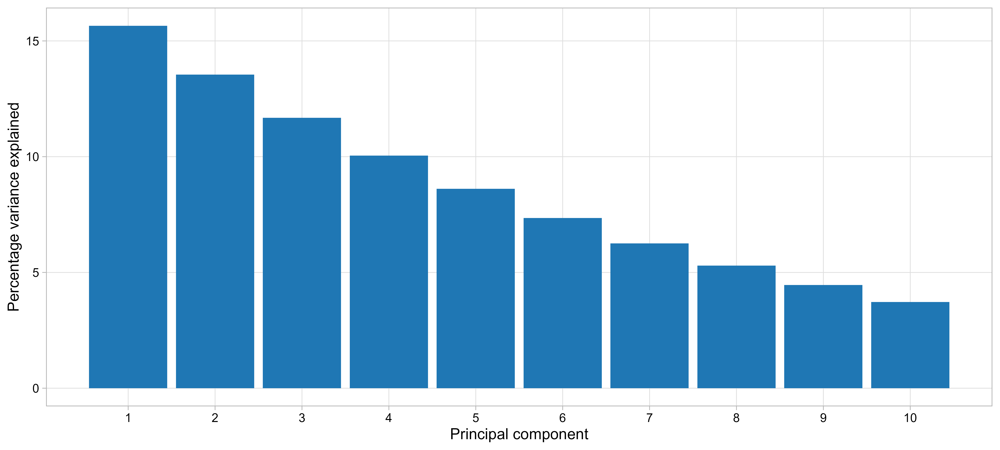

```r
PCA_Scree_Plot("pca.eigenval", out_file = "out/pca_scree.png")
```

### 3. 三维 PCA

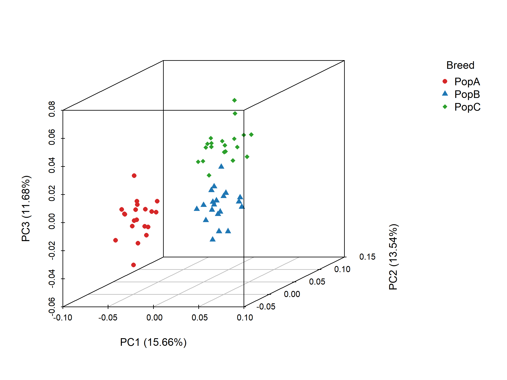

```r
PCA_3D_Plot("pca.eigenvec", "pca.eigenval", "group.csv",
            group_col = "Breed", out_file = "out/pca_3d.png")
```

### 4. ADMIXTURE 堆叠柱（K = 2..9）

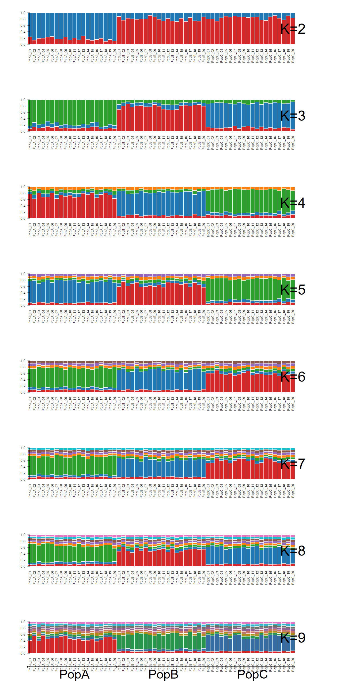

```r
Admixture_Plot(
  sname       = "samples.csv",     # 需要 sampleID + breed 两列
  file_prefix = "admixture/bestqc.",   # 对应 bestqc.2.Q ... bestqc.9.Q
  out         = "out/admixture",
  k_range     = 2:9,
  out_type    = "pdf"
)
```

### 5. Fst 曼哈顿图

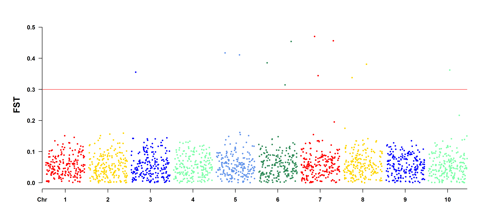

```r
FST_Manhattan_Plot("fst.txt",          # SNP / CHR / BP / FST 四列起
                   out_dir = "out",
                   memo    = "FST",
                   threshold = 0.3)
```

### 6. LD 衰减曲线

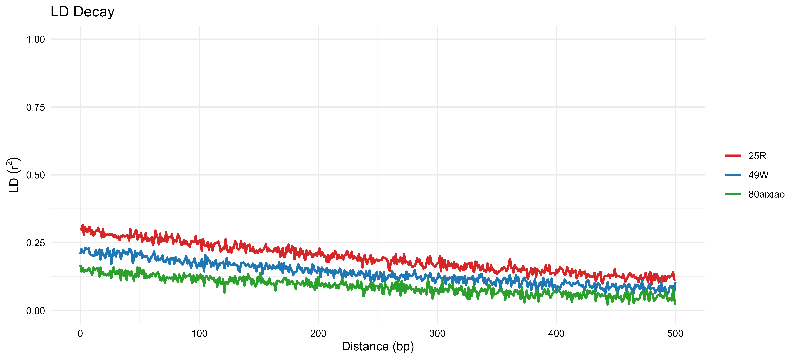

```r
LD_Decay_Plot(
  files = c("25R"      = "25R.stat.gz",
            "49W"      = "49W.stat.gz",
            "80aixiao" = "80aixiao.stat.gz"),
  out_file = "out/ld_decay.png"
)
```

分箱取均值让曲线更顺（对应原始脚本第二种画法）：

```r
LD_Decay_Plot(files, bin_size = 20, out_file = "out/ld_decay_smooth.png")
```


### 7. SNP 密度图

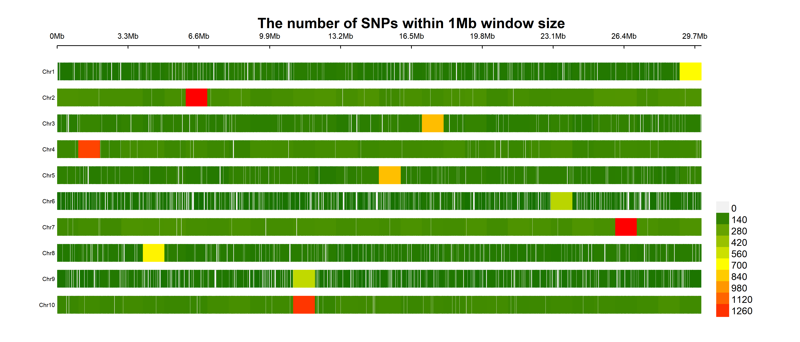

```r
SNP_Density_Plot("snp_pos.txt",        # 两列：CHR  BP（不含表头）
                 out_dir = "out",
                 bin_size = 1e6)       # 1Mb 窗口
```

本质是 `CMplot(plot.type = "d")`，和
[SROnline 在线工具](https://www.bioinformatics.com.cn/plot_basic_SNP_density_by_CMplot_107)
是同一个实现，区别是可以本地批量跑。

### 8. 系统发育树 + 祖先成分饼图

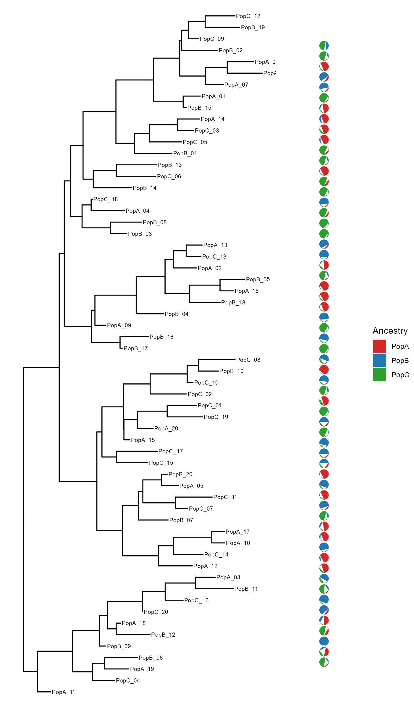

```r
Tree_Pie_Plot("tree.nwk", "pie.csv", out_file = "out/tree_pie.png",
            width = 7, height = 12)
```

`pie.csv` 格式：第一列是叶节点名，后面每列一个祖先成分的比例。

```csv
Tip,PopA,PopB,PopC
Sample01,0.80,0.15,0.05
Sample02,0.10,0.85,0.05
```

依赖（`treeio` / `ggtree` 在 Bioconductor，国内镜像常 404，直接用官方源）：

```r
install.packages("patchwork")
install.packages(c("treeio", "ggtree"),
                 repos = c("https://bioconductor.org/packages/3.20/bioc",
                           "https://mirrors.tuna.tsinghua.edu.cn/CRAN/"))
```

> 实现上**没有**用常见的 `ggtreeExtra::geom_fruit` + `scatterpie`——那套组合在
> ggtreeExtra 1.16 + scatterpie 0.2.x + ggplot2 3.5.2 下会报
> `argument "cols" is missing` 和 `could not find function "from_theme"`。
> 这里改成 ggtree 画树 + 手工算扇形多边形 + patchwork 拼接，见 `AGENTS.md` 已知坑 8。

### 9. XP-CLR 曼哈顿图

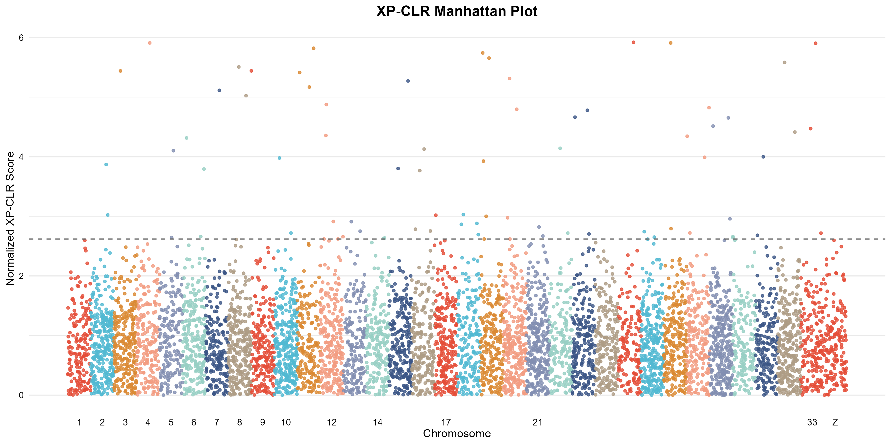

```r
XPCLR_Manhattan_Plot(
  xpclr_file = "xpclr.txt",        # chrom / start / stop / xpclr_norm
  out_file   = "out/xpclr.png",
  top_pct    = 0.05,
  top_out    = "out/xpclr_top5.txt"   # 顺手导出前 5% 位点
)
```

33 条常染色体 + Z 用累加坐标拼在一起，8 色循环，99% 分位画虚线。
`highlight_chr = "Z"` 让 Z 强制用第一色（原脚本的行为）。

### 10. XP-EHH 曼哈顿图

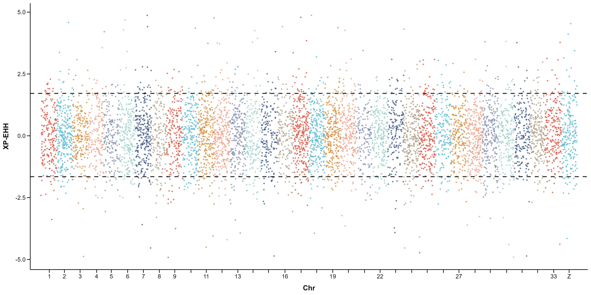

```r
XPEHH_Manhattan_Plot(
  xpehh_file = "xpehh.txt",        # 8 列无表头，第 1 列是 "chr:pos"
  out_file   = "out/xpehh.png"
)
```

上、下各取 5% 作双尾阈值，两条黑色虚线。

### 11. 韦恩图（复刻 Venny 2.1）

对标 <https://bioinfogp.cnb.csic.es/tools/venny/index.html>：
彩色半透明叠加、每个区域显示元素数、3 集合三角形布局、4 集合对称四椭圆。

**2 集合**

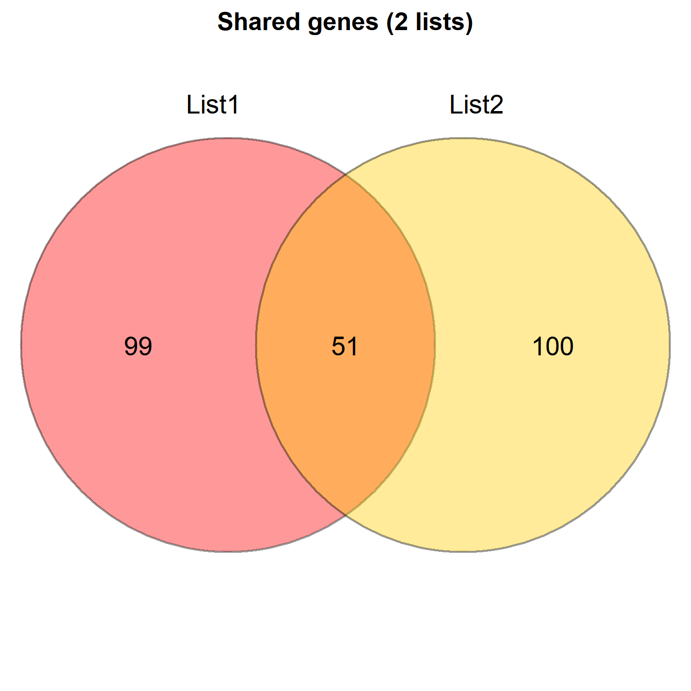

```r
Venn_Plot(list(`List 1` = genesA, `List 2` = genesB),
         out_file = "out/venn_2sets.png")
```

**3 集合**

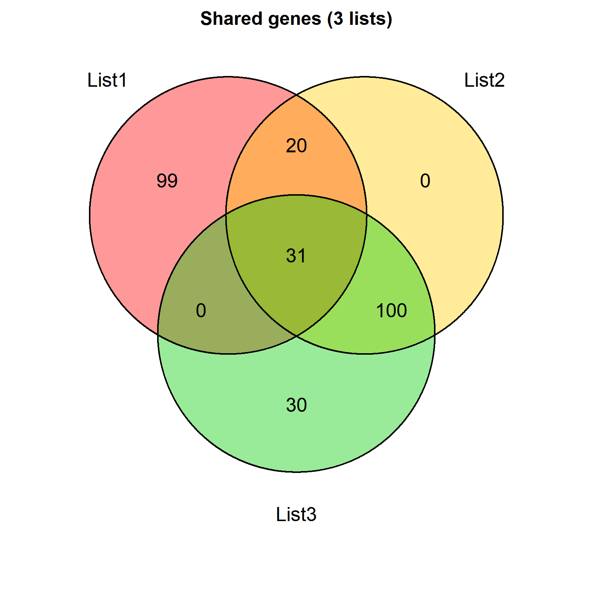

```r
Venn_Plot(list(`List 1` = genesA, `List 2` = genesB, `List 3` = genesC),
         out_file = "out/venn_3sets.png")
```

**4 集合**（顺带导出每个区域的元素明细）

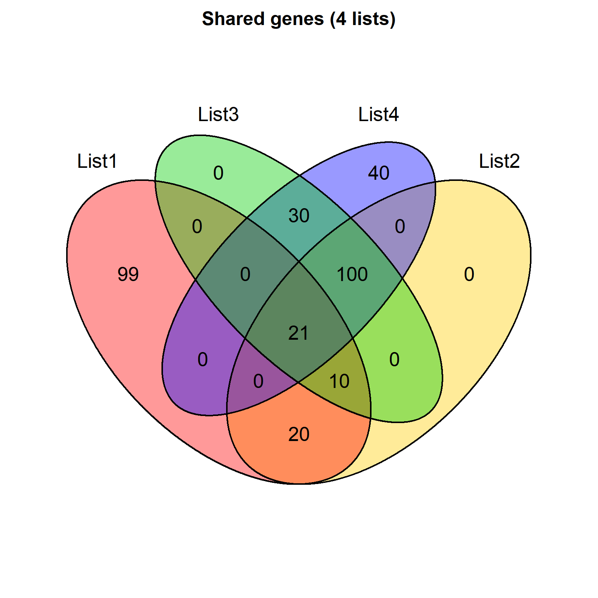

```r
Venn_Plot(list(A = setA, B = setB, C = setC, D = setD),
         out_file   = "out/venn_4sets.png",
         detail_out = "out/venn_regions.tsv")
```

细节：

- 配色默认走 `PALETTE_VENN`（Venny 的红黄绿蓝），可用 `colors` 换
- `alpha` 控透明度，`line_width` 控边框，`cat_cex` 控集合名字号
- 返回 `list(plot, counts, regions)`，`regions` 就是每个区域里具体有哪些元素
- 返回值是 grid grob，**不是 ggplot**，所以不走 `save_popgen()`

> 实现细节：3/4 集合用 `VennDiagram` 包（关键是把 `euler.d` 和 `scaled` 关掉，
> 否则会画成按比例缩放的欧拉图）；2 集合是手写的 grid 版本，因为
> `draw.pairwise.venn` 在 `cat.dist` 传向量时会把 area1 画到右边、颜色错位、
> 集合名叠在正上方。详见 `AGENTS.md` 已知坑 9。

---

## 样式在哪改

全部在 `R/theme_popgen.R`：

```r
PALETTE_POPGEN    # 8 色群体配色（前三位贴近红/蓝/绿）
PALETTE_CHR       # Fst 曼哈顿图的 6 色染色体交替
PALETTE_CHR8      # XP-CLR / XP-EHH 的 8 色循环
PALETTE_VENN      # 韦恩图配色（红黄绿蓝，Venny 默认）
POPGEN_POINT_SIZE # 散点大小，默认 2
POPGEN_BASE_SIZE  # 字号基准，默认 11
POPGEN_WIDTH      # 默认导出宽，10 英寸
POPGEN_HEIGHT     # 默认导出高，4.5 英寸
POPGEN_DPI        # 默认分辨率，500
```

**只改这一个文件，所有图同步变。** 不要在单个作图函数里写死颜色和尺寸。

---

## 与原始脚本的差异

代码核心（画法、几何对象、图层结构）保持不动，以下是有意修改的地方：

| 文件 | 改动 | 原因 | 如何退回 |
|---|---|---|---|
| `PCA_2D_Plot` | 椭圆填充色改为与散点同色 | 原脚本椭圆用 ggplot 默认色，与点的红/蓝/绿不匹配 | `ellipse = FALSE` 去掉椭圆 |
| `PCA_2D_Plot` | 按 `SampleID` 对齐分组，不再按行号 | 行顺序不一致时原代码会张冠李戴 | — |
| `PCA_3D_Plot` | 不再删 `eigenvec` 第一行 | 原脚本 `eigenvec[-1, ]` 会静默丢掉第一个样本 | `drop_first_row = TRUE` |
| `PCA_3D_Plot` | 只画一次图例 | 原脚本写了三遍 `legend()`，图上会叠两层 | — |
| `Admixture_Plot` | `rainbow(K)` → 统一色板 | 配色统一 | 传 `colors` 参数自定义 |
| `Admixture_Plot` | `dev.off()` 改为条件调用 | 原代码无条件关闭，会误关用户的绘图设备 | — |
| `Admixture_Plot` | `family = "GB1"` → `font_family` 参数 | GB1 是 Windows 专有字体，换系统直接报错 | `font_family = "GB1"` |
| `Admixture_Plot` | PNG 像素尺寸参数化 | 原为写死的 `2000*10 × 1500*10` | 默认值与原值相同 |
| `FST_Manhattan_Plot` | `memo` → `file.name` | CMplot ≥ 4.0 的 API 变更 | — |
| `LD_Decay_Plot` | `theme_minimal()` → `theme_popgen_minimal()` | 保留无网格观感，字号走统一常量 | 换回 `theme_minimal(base_size = 14)` |
| `LD_Decay_Plot` | y 轴标签改用 `expression(LD~(r^2))` | 原字符串 `"LD (r²)"` 的 Unicode 上标在部分 PDF 字体里缺字 | 传 `ylab = "LD (r²)"` |
| `xpclr作图.R` → `XPCLR_Manhattan_Plot` | 手写脚本改成函数 | 原脚本文件名、输入文件、输出文件全是硬编码 | — |
| `XPEHH分析作图.R` → `XPEHH_Manhattan_Plot` | 手写脚本改成函数 | 同上；另外原脚本末尾有一大段重复的排序/阈值计算，已删掉 | — |
| `XPCLR_Manhattan_Plot` | `theme_minimal()` → `theme_popgen_minimal()` | 字号统一，观感不变 | — |
| `XPEHH_Manhattan_Plot` | `theme_classic()` → `theme_popgen_classic()` | 字号统一，观感不变 | — |

配色从 `rainbow()` 换成了固定色板——这是「统一」的代价。前三色仍是红/蓝/绿系，
和旧图能对上。想完全还原 `rainbow()`，自己传 `colors` 参数。

---

## 数据格式

### 分组表（PCA 用）

```csv
SampleID,Breed
PopA_01,PopA
PopA_02,PopA
```

### ADMIXTURE 样本表

```csv
sampleID,breed
PopA_01,PopA
```

Q 文件命名：`<前缀><K>.Q`，如 `bestqc.3.Q`，每行一个样本，K 列，行和为 1。

### PLINK PCA

- `.eigenvec`：`FID IID PC1 PC2 ...`，空格分隔，无表头
- `.eigenval`：每行一个特征值

### Fst（CMplot 输入）

```
SNP	CHR	BP	FST
chr1_00001	1	15234	0.0213
```

---

## 依赖

基础作图（已全部验证跑通）：

```r
install.packages(c("ggplot2", "dplyr", "readr", "data.table",
                   "scatterplot3d", "CMplot", "VennDiagram"))
```

进化树饼图额外需要（可选，不装不影响其它图）：

```r
install.packages("patchwork")     # CRAN
install.packages(c("treeio", "ggtree"),
                 repos = c("https://bioconductor.org/packages/3.20/bioc",
                           "https://mirrors.tuna.tsinghua.edu.cn/CRAN/"))
```

> Bioconductor 包建议直接用上面的官方源 + 清华 CRAN 混合源。
> 用 `BiocManager::install()` 会先访问 `config.yaml` 校验版本，网络不稳时直接超时报错。

> **注意**：Windows 上如果 `source()` 报 `invalid input found`，是 R 的 locale 问题，
> 不是文件坏了。`R/load_all.R` 已内置处理，详见 `AGENTS.md` 的「已知坑 1」。

---

## 给 AI 用

把仓库地址直接丢给 AI，或本地 clone 后让它读。第一句提示词：

> 读 AGENTS.md，然后按里面的规范帮我画 XX 图。

`AGENTS.md` 里写了铁律、函数签名、样式常量、数据格式、加新图的流程和已知坑。
